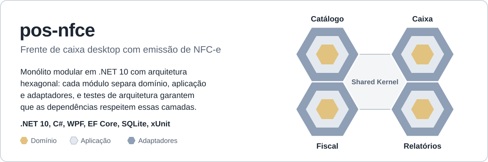

<picture>
  <source media="(prefers-color-scheme: dark)" srcset="assets/header-dark.svg">
  
</picture>

Sou desenvolvedor full stack e trabalho principalmente com Laravel, Next.js, TypeScript e React Native, construindo aplicações web e mobile do back-end ao front-end. Gosto de entender bem o problema antes de escrever código e de deixar o que construo testado e fácil de manter. Hoje meu maior interesse está em arquitetura de software e padrões de projeto, e tenho explorado o ecossistema .NET em projetos pessoais.

### Projeto em destaque

<a href="https://github.com/JoaoVACoelh/pos-nfce">
  <picture>
    <source media="(prefers-color-scheme: dark)" srcset="assets/pos-nfce-dark.svg">
    
  </picture>
</a>

Em desenvolvimento: cadastros e fluxo de venda já funcionam, e a próxima etapa é a transmissão da NFC-e para a SEFAZ.

### Contato

[LinkedIn](https://www.linkedin.com/in/joao-vacoelho) · [joaoarantes877@gmail.com](mailto:joaoarantes877@gmail.com)
